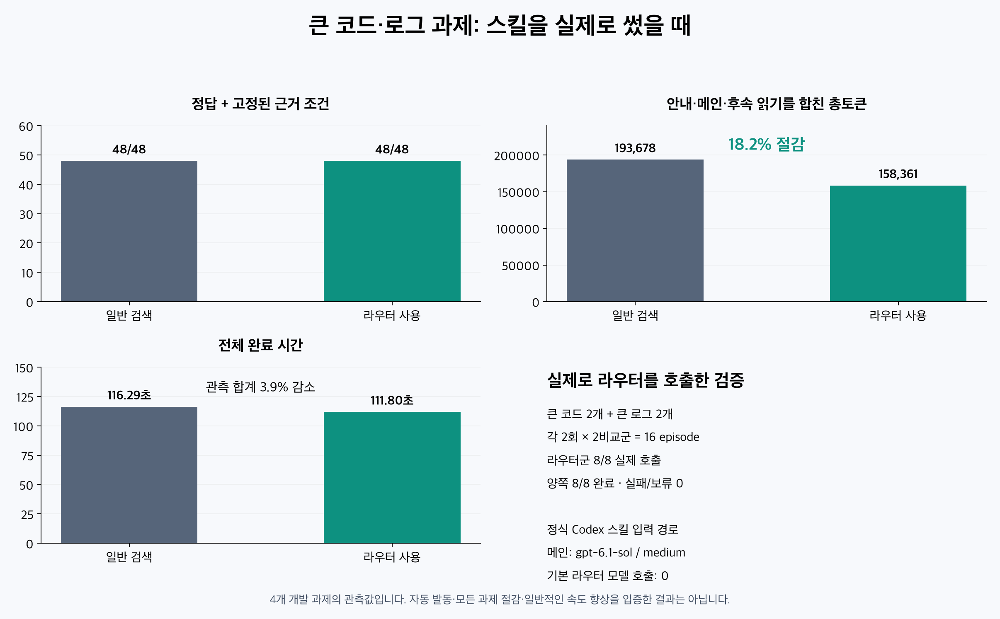

# Token Router

Retrieve bounded original lines from large Python files and logs before a reasoning model reads them. **Python-only by default: no model, login, network or source execution.** It returns evidence, not summaries or semantic confidence.

**v2.7.0 · Python3.10–3.14 · standard library · Linux/macOS/Windows.** [Support and validation](docs/release-readiness.md).

## Install

```sh
git clone --branch v2.7.0 --depth 1 https://github.com/sleeplesshan/token-router.git
cd token-router
python3 scripts/install.py install --dest "$HOME/.agents/skills/token-router"
python3 "$HOME/.agents/skills/token-router/scripts/router.py" --version
```

Or download the versioned archive and SHA-256 from [Releases](https://github.com/sleeplesshan/token-router/releases), verify it, extract it and run its installer. A checksum verifies integrity, not publisher identity. Use a reviewed pinned source. Windows PowerShell: use `python` and `--dest "$env:USERPROFILE/.agents/skills/token-router"`. Only21 allowlisted runtime/support files are installed; research sources, raw events and benchmark tools are excluded. An unmanaged copied installation is never overwritten; install to a new destination first.

## Choose the smallest adequate read

Use ordinary search for a literal answer or an already-known short range. Reuse visible evidence. Routing is useful when search leaves dispersed failure context or a branch/order question needs complete named Python definitions. File size alone does not make it worthwhile.

```sh
# Complete explicitly named callables, batched; no dependency traversal.
python3 scripts/router.py heavy_code path/to/module.py \
  --symbol Store.lookup --symbol helper --line-numbers --compact-status

# Exact failure-header fragments and a dispersed summary, batched.
python3 scripts/router.py error_log path/to/ci.log \
  --search-term 'ERROR: worker (' --search-term 'Total test files:' \
  --line-numbers --compact-status

# Existing general query path: default local tokens / v2.4 policy.
python3 scripts/router.py heavy_code samples/service.py --query retry_delay
python3 scripts/router.py agent_context samples/reference.md --query rollback
```

Resolve the script relative to the installed skill, not the current project. `$token-router` works with skill-capable hosts; [SKILL.md](SKILL.md) gives the retrieval instructions. Prefer a host that supplies the guide before execution, and never read it again when already provided. Plain text naming a skill is not necessarily native skill injection: the validated Codex path uses its registered skill input. [Claude Code](CLAUDE.md) can use the same local CLI manually. Automatic discovery is guidance dependent on the host, not middleware that intercepts every read.

## What is returned

`--symbol QUALNAME` selects1–8 unique functions/async methods, including decorators, in Python up to1,000,000 decoded characters. Nested/overlapping definitions merge. Missing/duplicate names, invalid syntax or an oversized batch withhold the entire output. Complete definitions do not include dependencies or enclosing runtime conditions.

`--search-term TEXT` is repeated, case-sensitive substring selection. Logs match ANSI-SGR-stripped text while preserving the original lines. Default neighbors: logs4, code12; `--search-context 0..12` explicitly changes only this path. Selected recognizable Python/pytest failure blocks can extend to their end marker within64 lines. All formats and complete dependencies are not promised. Prefer distinctive headers over frequent bare test names.

Both explicit readers cap their whole rendered packet at12,000 characters plus the common output limit; they never silently cut a function or window. `--line-numbers` labels the original1-based lines. `--compact-status` reduces stderr presentation, preserving useful failure coordinates; `--report-json PATH` retains detailed diagnostics. Verify that the returned lines actually support each claim and read only missing context.

| Status / exit | Meaning |
|---|---|
| auto_full /0 | Whole decoded source |
| auto_candidates /0 | Excerpt; verify evidence |
| needs_targeted_read /2 | Empty source output; narrow or read specific ranges |
| usage_error /2 | Correct the command |
| error /1 | Input, source change or report failure; empty source output |
| fallback /0 | Optional selector failed; inspect model_failed |

The general query policy remains **v2.4**, with **v2.5 opt-in**; return-context remains off. Optional `--return-context bounded`/`--return-target QUALNAME` are separate existing features. Shared stat/path+descriptor checks, strict model-visible coordinates and final rendered output cap remain in every path. Metadata checks are not atomic snapshots. UTF-8 replacement and LF normalization preserve decoded lines, not exact original bytes. [Complete CLI contract](references/contract.md).

## Measured value and limits

In4 contextual development tasks (large pandas/Rich code and CPython/SciPy logs), two repeats per arm with native Codex skill input:

| Measure | Ordinary search | Router |
|---|---:|---:|
| Fixed-rubric correct answers + source evidence |48/48|48/48|
| Successful episodes |8/8|8/8|
| Total input + output, including guide/main/recovery |193,678|158,361 (-18.23%)|
| Whole episode wall sum |116.29s|111.80s (-3.86%)|
| Actual router calls |0|8|



This is a measured **explicit native invocation** path, not proof of automatic selection or universal savings. Pandas was effectively flat (one repeat increased tokens); CPython used fewer tokens but took21.47% longer. A separate cold CLI delivery used24.12% more tokens because of an additional guide-reading roundtrip and an overly broad failed extraction. Those losses and all48 new main turns/1,050,651tokens are retained. The guide-inserted experiment is separate. [Full report, per-episode packets, hashes and raw events](docs/actual-reader-review/report.ko.md).

Queries answerable by one small search should bypass the skill. The15% rendered-character margin is a heuristic against whole-source size, not a guarantee against efficient ordinary search. New project holdouts, cold implicit savings and other main models remain unmeasured. Use sufficient full context for broad audits and cross-file work. Never route mandatory instructions. Historical [v2.5 evaluation](docs/benchmark-v2.5.md) and other reports retain their original versions and scores.

## Update, restore, remove

Run the new reviewed checkout/archive's installer. It verifies existing managed hashes, refuses edits/extras/symlinks, validates staging and prints a backup location outside skill discovery.

```sh
python3 scripts/install.py update --dest "$HOME/.agents/skills/token-router"
python3 scripts/install.py verify --dest "$HOME/.agents/skills/token-router"
python3 scripts/install.py restore --dest "$HOME/.agents/skills/token-router" --backup /verified/backup
python3 scripts/install.py uninstall --dest "$HOME/.agents/skills/token-router"
```

It does not change AGENTS, other skills, model configuration or auth. Keep personal edits separately. Roll back with a verifiedv2.6.0 archive/tag or the installation backup.

## Development / advanced use

```sh
python3 -m unittest discover -s tests
python3 scripts/run_router_tests.py tests/router-tests.json
python3 scripts/build_release.py --output dist
python3 scripts/smoke_archive.py dist/token-router-2.7.0.zip
```

These checks are offline and make no model call. Optional cloud/legacy latency selection is an advanced POSIX compatibility path using fixed `gpt-6-luna`/low via Codex login. It is never automatic, not required, and live Luna access is unvalidated for this release. Your main agent can separately send the extracted evidence to its own model.

[CONTRIBUTING](CONTRIBUTING.md) · [SUPPORT](SUPPORT.md) · [SECURITY](SECURITY.md) · [MIT license](LICENSE). Public samples are synthetic; third-party benchmark material has [separate provenance/notices](docs/actual-reader-review/SOURCES.md).
