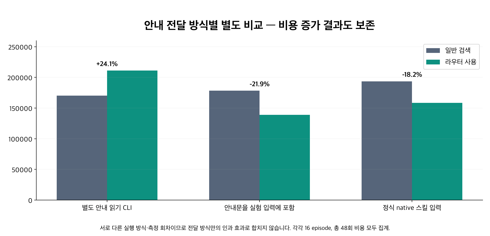
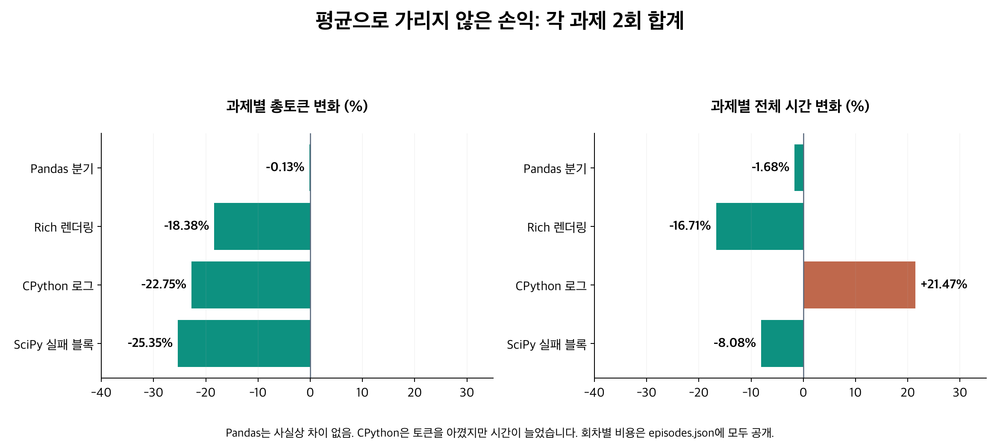

# 실제 발동 검증과 2.7.0 출시 판단

2026-10-13. **채택: 명시적 로컬 추출 기능.** 정식 Codex 스킬 입력 경로에서 큰 코드·로그 과제 4개를 각 2회 비교했다. 라우터군 **8/8 실제 호출**, 양쪽 사전 고정 rubric의 정답·근거 조건 **48/48**, 완료 **8/8**. 총 input+output은 **193,678 → 158,361 (18.23% 절감)**, 전체 episode wall 합계는 **116.29 → 111.80초 (3.86% 감소)**였다. 자동 발동이나 모든 과제의 절감을 보장하는 결과가 아니다. v2.4 기본 판단, v2.5 선택 정책, 공통 안전 계약과 15% 문자 감소 기준은 그대로다.

## 실패 원인과 수정

첫 실제 발동 비교 `run-01`도 삭제하지 않았다. 일반 검색170,105 대비 라우터211,136토큰(**+24.12%**), wall109.17 대비136.20초였다. 관측된 주요 증가 원인은 별도 안내 읽기와 넓은 literal 범위다. 전체 증가분을 한 원인에 인과적으로 귀속하지 않는다. 원문이 짧아져도 CLI가 `cat SKILL.md`를 먼저 실행해 메인 모델 왕복을 추가했다. `pandas_dispatch-1-router`는 원문8,091자를 전달했지만 일반 검색10,870자보다 총토큰이 더 컸다. `cpython_trace-1-router`는 반복되는 bare test name으로 검색 범위를 과도하게 늘려 exit2 후 추가 원문 읽기를 수행했다. 이 실패 추출과 재전달·메인 비용은 모두 포함했다. 파일 크기만으로 절감을 판단할 수 없다.

- `scripts/router.py::symbol_packet`: 정확히 지정한 Python callable의 완전한 정의·decorator를 배치로 반환한다. 이전 literal 창은 이 두 코드 과제에서 예산 초과로 원문을 반환하지 못했다. 문서 뒤나 함수 후반을 다시 읽는 문제를 피하되 의존성 그래프나 enclosing condition은 확장하지 않는다.
- `literal_search_packet`: 선택한 인식 가능한 pytest 실패 블록을 64줄 안의 file:line:exception 종료 표식까지 보완한다. 이전 SciPy packet은 충분 근거1/6, 새 packet은6/6이다. Python traceback과 기본 ±창을 유지하고 raw source는 바꾸지 않는다.
- `finalize_packet`: `--compact-status`에서 성공 packet에 이미 있는 symbol 좌표를 반복하지 않는다. 실패 witness는 최대12개와 occurrence/truncation 진단으로 남기고 JSON 보고서는 유지한다. 대량 중복 정의가138k자 stderr를 만들던 반례도 제한했다.
- `SKILL.md`, `agents/openai.yaml`: 완전한 정의가 필요한 branch/order 검토와 분산 실패 문맥에 사용을 한정한다. 이미 받은 안내·원문을 다시 읽지 않고, 로그에서는 반복 bare name보다 고유한 실패 헤더를 선택한다. 작은 literal 조회·알려진 한 줄 범위·충분한 원문에는 사용하지 않는다.

읽기 전에 실행하는 `cat guide; router` 배치안은 dual-brain 검수에서 기각하고 실제 시험 전에 제거했다. `run-02`는 실험자가 안내를 초기 입력에 붙인 별도 전달 방식 실험이다. 비용은178,245 →139,126이었으나 이를 정식 호스트나 자동 발동 검증으로 취급하지 않았다. 최종 `run-native`는 **설치된 스킬의 name/path를 정식 SkillUserInput으로 전달**했다. 실험자가 guide 본문을 붙이지 않았으며 native host가 실행 전 안내를 주입했다. 실제 안내 토큰은 메인 usage에 포함됐고 별도 guide read는0회였다. 기본 경로의 selector 호출은0회다.

## 비교 조건과 채점

큰 파일은 pandas447,104byte, Rich101,361byte, CPython551,037byte, SciPy638,795byte다. 두 코드는 여러 메서드의 앞뒤 분기·순서를, 두 로그는 실패 전체와 떨어진 후반 결과를 묻는다. 공통 최초 헤더 검색만으로 충분한 항목은 각각0/6,0/6,1/6,1/6이었다. 따라서 단순한 한 검색으로 끝나는 literal 조회와 다르다. 일반 검색은 효율적인 **배치 rg·줄 읽기·안전한 AST 조회**를 사용할 수 있었다. 대부분 한 배치 읽기로 답했으며 이를 의도적으로 약하게 만들지 않았다.

4개 개발 과제 ×2비교군 ×2회=16 episode. 같은 질문·파일·초기 헤더 검색·추가 원문 명령3회 상한, `gpt-6.1-sol`/medium, Codex0.162.1·기존 ChatGPT 로그인·builtin OpenAI. 순서는 교대했다. 후보군은 실제 경로 시험이므로 첫 원문 추출을 라우터로 수행하도록 명시했다. 자동 선택 능력은 미입증이다. 전 회차의 input+output을 합하고 cached input/reasoning output 부분집합을 중복 합산하지 않았다.

원래 gold와 scores를 보존했다. 독립 Left 검수가 원문과 대조해 p3의 comment 좌표, c6의 빈 줄/SEGV 좌표, s5의 빈 줄/terminator 좌표와 self./단위 표기 동등성을 확인했다. **별도 adjudicated manifest를 두 번째·native 실행 전에 고정**했다. Cold 원래 엄격 점수38/48·39/48은 그대로 공개하고 수정된 보조 점수를 별도로 제공한다. Native에는 이 사전 고정 기준을 동일하게 적용했다. `run-02` baseline은 요청된 함수 맥락 인용 부족1건으로 엄격47/48이며 최종 native48/48과 섞지 않았다.

최종 원시 native 이벤트16개에서 usage가 마지막 원문 명령과 답변 뒤, turn/completed 전에 기록됐음을 확인했다. 저장된 command 수와 최신 cumulative input/output이 summary와 전부 일치한다. [native audit](native-audit.json). 실험용 client에는 RPC 중간/실패 종료의 이벤트 손실 가능성이 남아 있다. 이번16개 성공 trace는 원시 최종 이벤트로 전수 재검산해 사용량·명령 일치를 확인했으며, 실행기 전체의 보편적 정확성을 주장하지 않는다. 호스트 schema의 native skill 입력, 설치 SHA, 원문·prompt·instruction hash, 모델 설정은 [execution lock](run-native-lock.json)과 [manifest](manifest-native.json)에 있다. 측정 package2.7.0, **commit3ad145c**, query 기본 정책v2.4, 명시 symbol/literal 선택이다. 출시 문서 변경은 이 runtime/skill hash와 구분한다. 전체 HTTP prompt 및 내부 transport retry 수는 노출되지 않는다.

## 정확성·비용·시간

| 지표 | 일반 검색 | 라우터 | 차이 |
|---|---:|---:|---:|
| 정답 + 충분한 인용 |48/48|48/48|유지|
| 최종 성공 완료 |8/8|8/8|유지|
| 총토큰 |193,678|158,361|-18.23%|
| episode 토큰 중앙값 |24,268.0|19,155.0|합계와 별도|
| 전체 wall 합계 |116.29s|111.80s|-3.86%|
| episode wall 중앙값 |14.19s|13.50s|합계와 별도|
| 원문 도구 호출 |8|8|실제 라우터8회|
| 실패/보류/복구 |0/0/0|0/0/0|정상 종료와 성공을 별도 판정|

| 과제 (각2회 합계) | 총토큰 | 변화 | 전체 wall |
|---|---:|---:|---:|
| pandas_dispatch | 36,793 → 36,745 | -0.13% | 28.67 → 28.19s |
| rich_render | 45,068 → 36,784 | -18.38% | 36.07 → 30.04s |
| cpython_trace | 52,289 → 40,395 | -22.75% | 20.94 → 25.44s |
| scipy_failure_blocks | 59,528 → 44,437 | -25.35% | 30.61 → 28.13s |

코드군 합계는-10.18%, 로그군은-24.13%다. **Pandas는 사실상 차이 없음**이고 첫 회차는98토큰 증가했다. CPython의 시간은21.47% 늘었다. 따라서 모든 작업에서 절감·속도 향상을 주장하지 않는다. episode별 paired 차이와 손해는 [summary](summary.json), 답·인용·실제 packet은 [episodes](episodes.json)에 보존했다.

로컬 처리 시간은 [오프라인 ablation](offline-ablation.json)의5회 실제 실행 분포와 native command duration을 별도로 기록했다. 옛 코드 경로의 빠른 exit2를 유용한 최적화로 세지 않았다. compact status는 stdout과 JSON 내용의 유지 여부, diagnostic 문자 수만 비교하며 문자 감소를 토큰 절감으로 환산하지 않았다. 전체 wall은 앱 서버 준비·한 메인 turn의 모든 요청/도구·종료를 포함한다. 공통 seed 자료 작성/다운로드는 이전 준비 단계다. 로컬 child CPU와 wall-CPU 잔여 시간을 공개했지만 잔여에는 대기·I/O·준비 비용도 있으므로 **순수 remote wait로 해석하지 않는다**. 이 소표본의 시간 차이는 서버 부하·캐시·모델 변동의 영향을 받는다.

## 오프라인 검증과 한계

Python3.10/3.14 macOS **181 tests**, 기존 manifest10/10, archive lifecycle smoke 통과. 별도 mixed24과제/8프로젝트 기본 packet은 publicv2.6.0 f68dc09의 기본v2.4 query packet과 동일했다. v2.5 release1737/defaultv2.4와의 별도 replay도 구분해 보존했다. source mutation·잘못된 model 좌표·긴 한 줄·최종 cap·기본 모델 호출0·명시 옵션 우선순위를 기존 회귀와 새9개 검사로 확인했다. 모호한 정의·과대 batch는 전체를 보류한다. source consistency는 snapshot 보장이 아니고 AST 성공은 semantic sufficiency가 아니다. 의미 충분성은unknown이다.

새 독립 프로젝트 잠금 평가, cold implicit discovery의 비용 절감, live Luna, 다른 main model은 미측정이다. 이번4개 파일은 기존 연구 자료/프로젝트 계열을 활용한 개발·회귀 자료다. 반복을 독립 과제로 부풀리지 않았다. 기본 query ranking/matcher, v2.4 기본값, v2.5 opt-in, shared source/coordinate/output 검증을 변경하지 않았다.

새3개 시리즈 **48 main turns·1,050,651 known tokens·724.58s**, main 실패/timeout/usage미상/재시도0, 실제 라우터24회. Cold의 예산 보류1건과 후속 원문 비용도 포함했다. 상한50 main turns/1.1M tokens; 내부 HTTP 요청 수는 미상이다. 과거 연구의 usage-unknown timeout은 별도 미해결 기록이며 이번 총량에0으로 넣지 않았다. 이를3개 시리즈 전체의 절감률로 뭉쳐 인과 효과를 계산하지 않는다.

## 재현과 rollback

- `python3 -m unittest discover -s tests`; `python3 scripts/run_router_tests.py tests/router-tests.json`.
- `python3 scripts/build_release.py --output dist`; `python3 scripts/smoke_archive.py dist/token-router-2.7.0.zip`.
- `python3 scripts/replay_release.py --workdir /fresh/directory --fetch`: 고정8프로젝트 offline replay, 원문 SHA 검증. 이미 결과가 있는 폴더는 재사용하지 않는다.
- 모델 원시 이벤트: [cold](run-01-events.zip), [inline](run-02-events.zip), [native](run-native-events.zip). Native 공개 발췌는 turn/started부터 마지막 완료까지 전부 포함하며 개인 installed-skill 목록/시작 환경은 제외했다. 원본 SHA와 공개 발췌를 구분한다. 인증 자료·원문 전체·연구 실행기는 설치 payload에 포함하지 않는다.
- 유지된 실행기·전체 원본: `/Users/han/Documents/Token/benchmarks/actual-reader-2.7.0-20261013/`, `python3 run-native.py`는 새 출력 경로와 동일한 hash의 설치본이 필요하다. 예산 설정 없는 반복 실행을 하지 않는다. 공개 [source provenance](SOURCES.md), prompt JSON, manifest, lock으로 입력 조건을 확인할 수 있다.
- 출시 rollback: 검증된v2.6.0 archive/태그f68dc09 또는 installer가 출력한 backup으로 restore. 검증 정책만 임의로 제거하거나 reset하지 않는다. 전역 AGENTS와 auth는 바꾸지 않는다.
