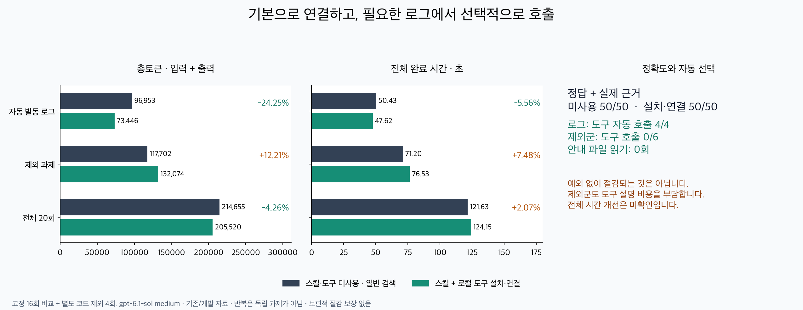

# Token Router2.8 자동 사용 검증

**제한된 자동 로그 경로를 채택한다.** 기본으로 연결된 로컬 도구가 여러
pytest 실패 블록과 떨어진 결과를 비교하는 질문에서 실제 발동했고, 두 로그
과제의 모든 반복에서 총토큰을 줄였다. 모든 과제의 절감이나 속도 향상은
입증하지 않았다. 단일 traceback·코드·이미 보이는 요약은 일반 검색으로
처리한다. 공통 안전 계약·v2.4 기본 판단·v2.5 선택 정책은 유지한다.



## 무엇을 측정했는가

최종 비교는16회 주 실험과 별도로 잠근4회 코드 제외 검사다.5과제×2군×2회,
총20episodes이며 반복은 독립 프로젝트가 아니다. 동일 task/repeat의 질문,
허용 파일, 최대3회 shell/로컬 읽기 기회와 출력 계약을 맞췄다. 검색군에도
효율적인 배치 검색·범위 읽기·전체 읽기·안전한 AST 처리를 허용했다.

사용군은 설치 스킬과 로컬 MCP 도구를 모든 과제에서 활성화했다. 사용자
입력은 양쪽 모두 같은 text-only이며 `$token-router`, SkillUserInput,
본문 강제 주입, 첫 도구 지정, 사후 정답 기반 selector는 없다. 실행 모델은
**gpt-6.1-sol medium**, Codex CLI0.162.1 내장 OpenAI/ChatGPT 로그인이다.
추가 selector 모델은0회다. 주 실험 상한16main turns/550000tokens,
회차60000tokens, 전체1800초, 절대240초/idle90초/grace10초; 코드 제외 검사
상한4turns/160000tokens. 실패·usage미상·품질 하락·잘못된 발동이면 중단한다.

| 스냅샷 | package / commit | 정책·설정 |
|---|---|---|
| 최초 암묵 스킬 |2.7.1 / c5509f1|v2.4,일반 발견·본문 읽기|
| 좁힌 본문 후보 |2.7.1 / de813cf|v2.4,복수 pytest만|
| 초기 MCP |2.7.1 /9e7c697|v2.4,기본 도구 노출|
| namespace 안내 |2.7.1 /4257adf|v2.4,초기 MCP 안내 보강|
| 최종 직접 노출 주 실험 |2.7.1 /4257adf|v2.4,omit_tools_from=[deferred]|
| 최종 코드 제외 검사 |2.7.1 /cb7c1cc|동일 adapter/guide/reader,설치 보완|
| 출시 |2.8.0 /릴리즈 manifest의 source_commit|동일 선택/packet,VERSION·UTF-8 stdout·설치·문서 보완|

이는 Frozenv2.4 원본 측정이 아니다.2.5 이후 출시 코드의 기본v2.4 판단과
공통 안전 검사 위에서 실행한 명시 literal/profile 경로다. 선택적v2.5를
측정하거나 자동 승격하지 않았다. 모든 입력·prompt·instructions·설치파일·
실행기 해시는 각 실험의 execution-lock/manifest에 있다. 공개 자료는 로컬
경로를 치환하므로 원본과 공개본 SHA를 별도로 기록했다.

## 최종 결과

아래 정답 수는 실제 보인 충분 근거를 인용한 사실 조건 수다. 과제 성공은
모든 조건 충족과 정상 완료를 함께 요구한다. 보류·정상 종료만으로 성공을
세지 않는다. 두 군 모두10/10episodes 성공,50/50조건을 충족했다.

| 범위 | 일반 검색 총토큰 | 설치·연결 총토큰 | 차이 | 일반/연결 전체 시간 합 |
|---|---:|---:|---:|---:|
| 자동 발동 로그 |96953|73446|−24.25%|50.43/47.62초(−5.56%)|
| 제외 과제 |117702|132074|+12.21%|71.20/76.53초(+7.48%)|
|20회 합계 |214655|205520|−4.26%|121.63/124.15초(+2.07%)|

16회 주 실험만 보면163607→144695(−11.56%),89.95→92.04초(+2.32%),38/38이다.
추가 코드 제외4회는51048→60825(+19.15%),12/12이며 도구0회다. 이를 숨기지
않고 합산했다. 별도 실험을 포함한20회 합계는 고정한 이 구성의 기술적
집계이며, 모든 실제 사용자의 과제 비율을 대표하지 않는다.

| 과제·각2회 | 토큰 합 일반→연결 | paired 차이(각 회) | 도구 호출 |
|---|---:|---:|---:|
| SymPy 두 pytest 블록 |39744→35860(−9.77%)|−2142,−1742|2/2|
| SciPy 두 pytest 블록 |57209→37586(−34.30%)|−7111,−12512|2/2|
| CPython 단일 traceback+결과 |52648→56463(+7.25%)|+2327,+1488|0/2|
| 이미 보이는 요약 |14006→14786(+5.57%)|+390,+390|0/2|
| pandas 코드 분기 |51048→60825(+19.15%)|+1516,+8261|0/2|

로그 실제 도구4/4, 제외군0/6, 안내 파일 읽기0회다. 복구·반복 호출·실행
거절·main timeout·retry·usage미상은 최종20회에서0이다. 모든 로컬 도구와
main/복구 비용은 실제 cumulative input+output에 포함했다. cached input과
reasoning output은 부분집합으로 기록하고 재합산하지 않았다.

전체 episode 중앙값은 토큰25524→18793,시간13.93→13.24초다. 합계·중앙값·
paired차이는 다른 지표이며 서로 대체하지 않는다. 도구4회의 로컬 실행
duration 합은308ms다. local CPU와 wall,wall−CPU proxy는 JSON에 분리했다.
이 proxy는 정확한 네트워크 대기 시간이 아니며 시간 개선으로 과장하지
않는다. SymPy의 시간은19.13→21.15초로 늘었고 SciPy는31.30→26.48초로 줄었다.

**제외군도 공짜가 아니다.** 직접 노출된 도구 schema와 setup skill의 발견
설명은 호출하지 않아도 입력 비용을 만든다. 가시 요약처럼 도구를 전혀
쓰지 않은 경우에도 매회390tokens가 늘었다. 다른 제외군에는 검색 계획·
모델 출력 변동도 함께 포함돼 있으므로 그 증가 전부를 schema 비용으로
귀속하지 않는다. 짧은 질문 위주의 사용자는 연결을 해제하는 편이 유리할
수 있다. 미래 총토큰 증가 여부를 실행 전에 완벽히 예측하는 기능은 없다.

## 실패 원인과 채택하지 않은 후보

첫 일반 암묵 후보16회는181644→179917(−0.95%),38/38였다. CPython은 두 회
모두 비용 증가, SciPy는 한 회 절감·한 회 증가했다. 모든 본문 읽기는
일반 검색과 함께 수행했지만 이후 reader 실행에 main 왕복이 필요했다.
이를 강한 자동 절감으로 발표하지 않았다.

좁힌 본문 후보의 새 SymPy 첫 비교는19577→28706(+46.63%)였다. 반환 원문은
11980→6676문자로 줄었지만 main 왕복이 늘어 총토큰이 증가했다. 본문만
짧게 하거나 자동 영역만 줄여서는 해결되지 않는 사례다. 품질/비용 중단
후 추가 회차를 수행하지 않았다.

초기 MCP는20694→25672(+24.05%),namespace안내 MCP는20068→20949(+4.39%)였고
양쪽 모두 도구0회다. 실제 선택이 없어 효용 검증으로 세지 않고 각각 첫
pair에서 중단했다. Codex 공식 노출 구현을 확인하고 작은 도구의 deferred
노출을 제외한 별도 후보에서4/4실제 호출을 관측했다. 이 차이가 모든 모델·
환경에서 동일하게 발생한다는 인과 결론은 내리지 않는다.

[all-attempt-ledger](all-attempt-ledger.json)는 이 작업의42main turns,
**917402known tokens**를 보존한다. 최종20회 비용420175와 기각 후보 비용을
분리하며, 서로 다른 후보를 섞어 최종 정책의 절감률을 계산하지 않는다.
모델 호출 전 다른 bundled skills 노출·실행기 syntax 문제는 수정됐으며
모델0회다. 과거 작업의 usage미상 timeout은 별도 역사 자료로 남아 있고
이번 검증이 그것을 소급해서0으로 바꾸지 않는다.

## 채점 보완과 자료 한계

SymPy 원래 잠금 rubric은 명시 QQ의 충분 대안에서 직접적인 line781과782를
빠뜨렸다. 원래5/6엄격 점수와 모든 gold/원시 출력은 보존했다. 실제
`domain=QQ` assertion을 인용한 line781은 충분하며, 별도 rubricv2에781/782를
추가했다. 최종 양군은 같은v2를 썼다. 이 채점 수정은 본문 후보의46.63%
비용 증가나 기각을 지우지 않는다.

SymPy CI 로그는 최초 수집 때 CPython/SciPy와 독립적인 새 로그 계열이었다.
그러나 그 결과를 본 뒤 직접 도구를 개발했으므로 최종 비교에서는 회귀·
개발 자료다. SymPy 프로젝트 자체도 과거 코드 실험에 등장했다. 이후 새
독립 잠금 평가를 통과했다고 표현하지 않는다. 한국어/영어 과제가 있으며
번역쌍을 별도 표본으로 세지 않았다. 작은 표본,단일 모델,실제 과제 분포
미측정 때문에 보편적 무열화나 전체 사용자 비용 절감을 주장할 수 없다.

## 구현·오프라인 ablation

- `mcp_server.py`: 제한된 read_pytest_failures 계약,stdline JSON-RPC,불변
  허용 루트,형식/경로/크기/시간 검사와 고정 reader subprocess. 원문 오류는
  raw결과 없이 구조화된 실패로 반환한다.
- `install.py`: 연결·해제,직접 노출 config-only CAS쓰기,변경된 사용자 설정
  보존,부분 설치 상태와 rollback. model/thread 요청은 허용하지 않는다.
- `distribution.py`: 정확히 기존21/current22inventory만 허용하고 원래
  backup을 정확히 복원한다. 임의 누락/추가/수정/링크는 계속 거절한다.
- SKILL/metadata: 일상 호출에서 본문 로딩을 요구하지 않는 setup/manual
  역할. 기본 판단·matcher·AST·선택 순위·15%margin·Luna범위는 바꾸지 않았다.

217단위 검사와10manifest시나리오를 Python3.10/3.14로 통과했다. 새 검사에는
실제 CLI→MCP raw동일성,원문 변경/escape/타입/timeout/출력 상한,모델 기본0,
등록 소유권/필터/설정변경/CAS/실패 후 복구/21→22migration가 포함된다.
최종4MCP packet을 각5회 원래 CLI와 비교해 전체 UTF-8stdout 해시가 같고
source opens는2회였다. local adapter 비용은[offline-ablation](offline-ablation.json)
에 있으며 로컬 최적화로만 해석한다. 메인 실험과 다른 단계의 숫자를
구현별 순수 인과 ablation이라고 부르지 않는다.

## 재현·rollback

공개 각 실험 폴더에는 manifest/prompts/instructions/lock/episodes/원시
이벤트ZIP·원시/공개 해시가 있다. source는[sources](sources/)와 출처/라이선스
[SOURCES](SOURCES.md)에 있다. `verify_evidence.py`는 공개 raw usage,동일 text-only
입력,command/MCP출력,기존 점수를 모델 호출 없이 재검사한다.

```sh
python3 docs/automatic-tool-review/verify_evidence.py
python3 -m unittest discover -s tests
python3 scripts/run_router_tests.py tests/router-tests.json
python3 scripts/build_release.py --output /tmp/reviewed-release
python3 scripts/smoke_archive.py /tmp/reviewed-release/token-router-2.8.0.zip
```

실모델 재실행은 공개 run.py/native_client.py의 `<workspace>`를 실제 검토한
checkout 위치로 바꾸고 sources/skill-config를 명시적으로 준비해야 한다.
원래 모델·prompt·자료·복구 budget을 유지하고 새 디렉터리에 저장한다.
기존 scores/gold/lock/event를 덮어쓰지 않는다. 공개 해시는 치환 전 원본
해시와 다를 수 있으며 raw-hashes가 양쪽을 구분한다.

권장 설치는 `install --dest ... --connect-codex`,기존 설치는 `connect-codex`다.
새 Codex 세션이 필요하다. rollback은 `disconnect-codex`,검증된 backup으로
`restore`,새 세션 순서다.21파일 구버전에는 MCP adapter가 없다. 전역 설치·
AGENTS동기화는 릴리즈 후 별도 배포 영수증으로 기록하며 저장소 merge만으로
전역 상태가 바뀌었다고 표시하지 않는다.
