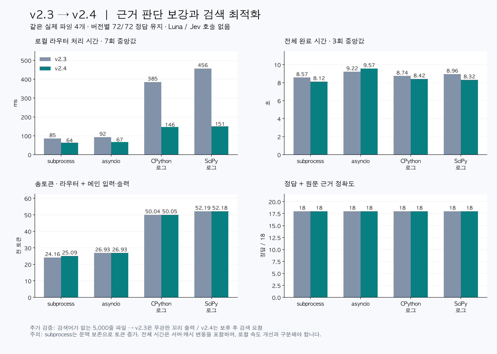

# v2.4: evidence checks, syntax boundaries, and faster matching

Compared with the frozen v2.3 router in new alternating-order paired runs on 2026-10-12. Four unchanged public real files, six factual questions each, three repeats per version: 24 main-model calls. Main model `gpt-6.1-sol`, medium reasoning. Neither router calls Luna/Jev or any local model. Tokens include all router + main input/output; cached input is a subset, not added twice. No recovery reads were needed. See [source provenance](benchmark-improvements.md).

Local router timing uses seven subprocess repetitions per file/version, alternating order, and excludes model inference. Model-run medians below include router + main. Timing is descriptive: service/cache variability is uncontrolled; local runs may overlap a waiting main-model request. These are regression files previously used in development, not a held-out accuracy claim.

| File | v2.3 total tokens | v2.4 total tokens | Change | v2.3 total seconds | v2.4 total seconds | v2.3 router ms | v2.4 router ms | Accuracy each |
|---|---:|---:|---:|---:|---:|---:|---:|---:|
| subprocess | 24,158 | 25,093 | +3.87% | 8.57 | 8.12 | 85.3 | 63.7 | 18/18 |
| asyncio | 26,930 | 26,932 | +0.01% | 9.22 | 9.57 | 92.5 | 67.3 | 18/18 |
| CPython log | 50,044 | 50,046 | +0.00% | 8.74 | 8.42 | 384.9 | 146.5 | 18/18 |
| SciPy log | 52,186 | 52,184 | -0.00% | 8.96 | 8.32 | 456.4 | 150.9 | 18/18 |

Both versions score72/72. Syntax completion adds evidence and increases subprocess token usage; this is a deliberate boundary-preservation cost, not a token-saving claim. Asyncio remains a full read. Log raw evidence is unchanged; small token differences are generated-answer variation. Faster local matching does not guarantee a proportional end-to-end speedup.

## Additional behavior checks

A new5,000-line synthetic source contains no requested `missing_symbol`. v2.3 emits1,340 characters from an unrelated tail as `auto_candidates`; v2.4 returns exit2, no raw output, and `next_action=search_query_terms`. This establishes correct lexical abstention, not proof of semantic absence. Missing queries are unknown; partial matches remain explicitly incomplete evidence.

Python syntax completion preserves a selected multiline statement's start/end when within12lines, adds at most128lines overall, and checks the final packet budget afterward. Larger crossing nodes remain partial; malformed Python retains original ranges with unknown status. New tests cover these cases, aggregate limits, no-match whole-read behavior, and exact Unicode/overlapping matcher semantics.48unit tests plus10fixture checks pass.58checks include existing regressions and new cases; they are not58 independent real-world tasks.

## Limits and design

Independent observable checks report lexical anchors, missing terms, syntax boundaries, reduction, and budget. These are not calibrated probabilities. Core-match evidence is calculated before neighboring expansion and can conservatively miss a match introduced by added context. AST parsing is limited to Python files up to1MB, but inspection time still depends on syntax/range counts. No complete function, dependency, or control-flow guarantee follows from completing short syntax nodes.

The indexed matcher preserves the previous matching semantics: ASCII simple terms use component indexing; complex terms and non-ASCII lines fall back to exact regex checks. The optimization is evidence-equivalent, whereas syntax expansion intentionally changes some code output. Default model calls remain zero. No automatic recovery loop or cloud escalation was added.

[Per-trial results and implementation hashes](benchmark-v2.4.json).

