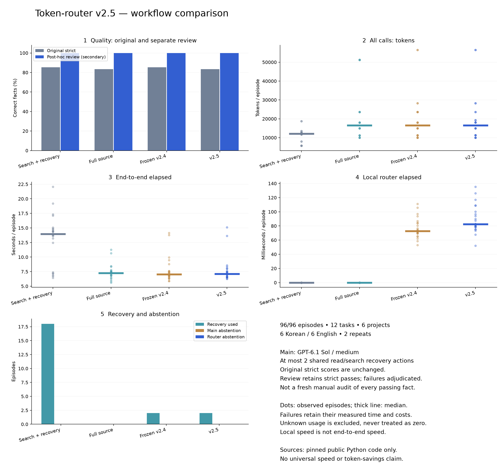

# Token-router v2.5 workflow benchmark

v2.5의 전체 속도·품질 우위는 이번 표본에서 확인되지 않았습니다. v2.4 대비 총토큰 합계는 -1.73%였지만 episode 토큰 중앙값은 +0.13%, 전체 시간 중앙값은 +1.43%였습니다. 엄격 정답은 41/48 → 40/48, 사후 보조 검토는 모든 방식 48/48입니다.

96개 episode에서 메인 모델을 총 120회 호출했습니다. 96개 전체에서 사용한 토큰은 1,743,046, episode 측정 시간 합계는 865.25초입니다. 실패·사용량 미상은 각각 0건·0건입니다.

완료 96/96 episode. 6개 독립 프로젝트의 새 Python 소스 task 12개(한국어 6·영어 6), 4개 방식, 각 2회 반복입니다. dev 4개와 locked 8개는 프로젝트별로 분리했습니다. 로그 벤치마크가 아닙니다.

각 방식은 같은 질문·명시적 검색 힌트와 최대 2회의 모델 요청 읽기 또는 검색을 사용할 수 있습니다. 복구당 최대 200개 새 줄·24,000자 제한이며 관련 파일은 고정 목록으로 제한됩니다. 전체 파일 방식도 같은 복구 기회를 받습니다.

원래 엄격 채점은 수정하지 않았습니다. 정확한 답과 사전에 정의한 충분근거 집합의 모든 줄이 인용 및 실제 전달 범위에 있어야 점수를 얻습니다. 사후 보조 검토 점수는 기존 엄격 통과를 유지하고 엄격 실패 항목에 독립 검토를 적용한 결과입니다. 모든 통과 항목을 다시 수동 감사한 점수가 아닙니다. pending 항목은 성공으로 간주하지 않습니다. 모든 main 호출 returncode가 0인 경우만 성공 점수에 포함합니다.

| 방식 | episode | 엄격 근거 정답 | 별도 검토 | 총토큰 중앙값 | 전체 시간 중앙값 | 로컬 라우터 중앙값 | 복구 episode | 기권 episode | 실패 / 사용량 미상 |
|---|---:|---:|---:|---:|---:|---:|---:|---:|---:|
| Search + recovery | 24 | 41/48 | 48/48 | 12,040 | 13.96s | 0.000s | 18 | 0 | 0 / 0 |
| Full source | 24 | 40/48 | 48/48 | 16,477 | 7.26s | 0.000s | 0 | 0 | 0 / 0 |
| Frozen v2.4 | 24 | 41/48 | 48/48 | 16,480 | 7.03s | 0.073s | 2 | 0 | 0 / 0 |
| v2.5 | 24 | 40/48 | 48/48 | 16,502 | 7.13s | 0.083s | 2 | 0 | 0 / 0 |

| 방식 | 정상 실행 완료 | 엄격 전체 정답 episode | 검토 전체 정답 episode | 알려진 총토큰 합계 | 시간 합계 | 초기 근거 누락 fact | 불충분 패킷 승인 episode | 라우터 기권 |
|---|---:|---:|---:|---:|---:|---:|---:|---:|
| Search + recovery | 24/24 | 17/24 | 24/24 | 274,145 | 314.53s | 32/48 | 해당 없음 | 0 |
| Full source | 24/24 | 16/24 | 24/24 | 515,948 | 178.18s | 0/48 | 해당 없음 | 0 |
| Frozen v2.4 | 24/24 | 17/24 | 24/24 | 480,632 | 186.21s | 2/48 | 2 | 0 |
| v2.5 | 24/24 | 16/24 | 24/24 | 472,321 | 186.33s | 2/48 | 2 | 0 |

초기 근거 누락은 첫 main 호출에 전달된 범위가 원래 gold의 충분근거 집합을 온전히 포함하지 않은 경우입니다. 불충분 패킷 승인은 라우터가 auto_full/auto_candidates로 승인했지만 이 조건을 충족하지 않은 episode를 뜻하며, 정책이 의미적 완전성을 약속했다는 뜻은 아닙니다. 복구 후 최종 오답과 별개로 셉니다. 정상 실행 완료는 모든 main 호출의 정상 종료이며 문제 해결 성공과 구분합니다. 라우터 기권과 모델의 INSUFFICIENT_EVIDENCE 기권도 별개입니다.

locked 자료에서 라우터 기권이 0회여도 기권 정책의 유용성이나 정확성이 입증된 것은 아닙니다. 아래 통제 정책 fixture는 분기의 작동을 검증하며 실제 corpus 정확도의 대체물이 아닙니다.

## 비용과 실패 처리

총토큰은 각 episode의 라우터와 모든 main·복구 호출 input + output의 합입니다. cached input은 input의 부분집합이고 reasoning output은 output의 부분집합이므로 더하지 않습니다. 사용량 미상은 0으로 대체하지 않고 토큰 집계에서 제외하며 건수를 표시합니다. 실패 episode의 알려진 비용과 시간은 포함합니다. 시간은 실제 episode 종료까지의 측정값입니다. 차트 점·범위는 관측값이며 신뢰구간이 아닙니다.

## 분리 검증

dev / locked, 언어, 프로젝트별 집계 및 paired 차이는 [benchmark-v2.5.json](benchmark-v2.5.json)에 있습니다. 전체 중앙값의 차이와 같은 task·repeat의 paired 변화율은 서로 다른 통계입니다. 두 번 반복은 통계적 일반화나 유의성 입증에 충분하지 않습니다.

## 로컬 구현 비교

| 입력 | 버전 | n | 중앙값 | guarded file open 중앙값 | 실패 |
|---|---|---:|---:|---:|---:|
| cpython_asyncio_connections | pre_optimization | 7 | 0.0874s | 6 | 0 |
| cpython_asyncio_connections | v2.4 | 7 | 0.0643s | 미계측 | 0 |
| cpython_asyncio_connections | v2.5 | 7 | 0.0882s | 6 | 0 |
| cpython_subprocess_timeout | pre_optimization | 7 | 0.0811s | 5 | 0 |
| cpython_subprocess_timeout | v2.4 | 7 | 0.0626s | 미계측 | 0 |
| cpython_subprocess_timeout | v2.5 | 7 | 0.0799s | 5 | 0 |
| cpython_ubsan_failure | pre_optimization | 7 | 0.1645s | 4 | 0 |
| cpython_ubsan_failure | v2.4 | 7 | 0.1414s | 미계측 | 0 |
| cpython_ubsan_failure | v2.5 | 7 | 0.1630s | 4 | 0 |
| scipy_distributed_failures | pre_optimization | 7 | 0.1684s | 4 | 0 |
| scipy_distributed_failures | v2.4 | 7 | 0.1514s | 미계측 | 0 |
| scipy_distributed_failures | v2.5 | 7 | 0.1685s | 4 | 0 |
| small | pre_optimization | 7 | 0.0416s | 5 | 0 |
| small | v2.4 | 7 | 0.0382s | 미계측 | 0 |
| small | v2.5 | 7 | 0.0382s | 1 | 0 |

소스 일관성 검사 등 새 보장에는 비용이 있습니다. v2.5의 최적화 전후 비교와 v2.4 대비 비교를 혼동하지 않습니다. guarded file open 횟수에는 일부만 읽는 probe도 포함되므로 전체 파일 순회 횟수로 해석하지 않습니다. 대형 파일에서 pre/post open 수가 같아도 전체 집계 순회를 bounded probe로 대체했을 수 있습니다. open 감소는 전체 모델 작업 시간 개선을 뜻하지 않습니다.

| 메모리 실험 버전 | n | 시간 중앙값 | peak RSS 중앙값 | 실패 |
|---|---:|---:|---:|---:|
| pre_optimization | 7 | 0.4724s | 51.52 MiB | 0 |
| v2.5 | 7 | 0.4693s | 51.38 MiB | 0 |

## 통제 정책 fixture

실제 모델 성능 실험이 아니며, v2.4 proxy는 기존 핵심 anchor 승인 조건만 분리한 비교입니다.

| Fixture | v2.4 proxy | v2.5 | 이유 |
|---|---|---|---|
| expanded_anchor | needs_targeted_read | auto_candidates | — |
| core_only | auto_candidates | needs_targeted_read | no_packet_query_anchor |
| lost_required | auto_candidates | needs_targeted_read | required_literal_dropped_from_packet |
| absent_required | auto_candidates | needs_targeted_read | required_literal_absent_in_this_source |
| explicit_required_preserved | needs_targeted_read | auto_candidates | — |

## 재현과 한계

측정 snapshot은 9bedcb1입니다. 이후 오류 경로·기본 정책의 오프라인 수정은 이 측정과 구분해야 하며 재실행하지 않은 release 전체의 측정값으로 표시하지 않습니다. manifest.json과 manifest.sha256은 task·원문 commit·SHA-256·허용 파일·질문·채점 기준을 고정합니다. runs/execution-lock.json은 모델·노력 수준·라우터 모듈 hash를 고정합니다. 개별 결과와 main 이벤트는 runs/에 보존되어 있습니다. 원본 scores는 이 보고서 생성기가 변경하지 않습니다.

이 자료는 공개 Python 코드만 다루며 로그·다른 언어·프로덕션 작업 전체를 대표하지 않습니다. 문자열·근거 채점은 독립적 의미 평가와 다를 수 있어 별도 검토를 분리했습니다. 총토큰을 구독 크레딧이나 금액으로 환산하지 않습니다.

## 채택 및 출시 결정

패키지는 **v2.5.0**으로 출시하지만 기본 판단 정책은 **v2.4**를 유지합니다. 공통 원문 변경 검사·모델 좌표 검증·최종 출력 상한은 모든 정책에서 적용하고, 최종 패킷/필수 literal 판단은 `--policy-version v2.5`로 선택합니다. 의미적 품질 우위나 보편적 무열화를 입증하지 못했으므로 자동 승격하지 않습니다. 정책 롤백은 옵션을 제거하거나 `--policy-version v2.4`를 선택하는 방식이며 공통 안전 검증을 되돌리지 않습니다.

측정 후 `62d2c56`에서 보고서 저장 직후 원문 변경 시 성공 보고서가 남는 문제, 전체 읽기 예산 초과 시 부재 진단 누락, witness 잘림 표시 및 병합 reason 길이를 보완했습니다. `ef29f6a`는 검증된 작은 파일 fast path를 기본 tokens 경로에도 적용합니다. `71258dd`는 향후 벤치마크의 중복 답 ID를 거부하고 부분 실패 비용 검사를 추가합니다. 기존 96회 결과와 엄격 채점은 변경하지 않았습니다.

측정 snapshot과 출시 코드의 **새 과제 12개 모두 stdout·종료 코드·메인 모델에 전달되는 제한된 진단이 동일**함을 오프라인으로 확인했습니다. 다만 출시 코드에서 96회 모델 측정을 다시 수행한 것은 아닙니다. 단위 검사 **96개**, 기존 manifest 시나리오 **10개**가 통과했습니다. 기존 실제 코드·로그 4개에서는 v2.4와 v2.5 원문 stdout 해시가 같았습니다. 메타데이터 검사는 원자적 snapshot 보장이 아닙니다.

작은 입력의 전체 순회/AST 생략 및 별도 문자 집계 순회 제거는 채택합니다. 관측된 큰 입력의 최적화 전후 차이는 작고 잡음과 구분하기 어려우며, v2.4 대비 새 안전 검사의 추가 비용이 있습니다. 이를 전체 속도 향상으로 표현하지 않습니다. 메모리 실험은 약 3.5 MB의 합성 로그 1개를 7회 측정한 제한된 확인입니다.

## 공개 검증 자료

- [고정 과제·공개 원문 commit/해시·gold](benchmark-v2.5-data/manifest.json), [manifest 해시](benchmark-v2.5-data/manifest.sha256)
- [96개 episode 원본 점수·답·인용·사용량](benchmark-v2.5-data/episodes.json)
- [별도 검토 내역과 근거](benchmark-v2.5-data/adjudication.json)
- [실행 설정·측정/출시 모듈 해시](benchmark-v2.5-data/execution-lock.json), [12과제 출력 동등성](benchmark-v2.5-data/release-equivalence.json)
- [로컬 ablation](benchmark-v2.5-data/local-ablation.json), [메모리 ablation](benchmark-v2.5-data/memory-ablation.json), [정책 fixture](benchmark-v2.5-data/policy-ablation.json)

메인 모델은 `gpt-6.1-sol`, reasoning `medium`으로 고정했습니다. 개발 16회 pilot은 총 96회에 포함됩니다. 기본 라우터의 실제 모델 호출은 0회이며 Luna 분기는 mock으로만 검증했습니다. 따라서 이번 결과는 Luna 품질 평가가 아닙니다. 원시 Codex 이벤트·프롬프트는 로컬 실험 폴더에 보존했고, 공개 자료에는 인증 정보를 포함하지 않았습니다.
