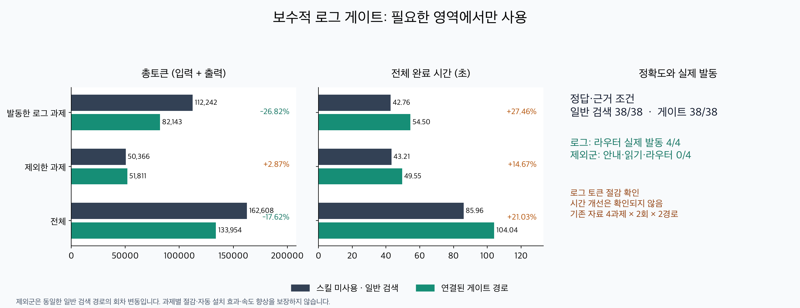

# 보수적 로그 발동 게이트 검증

**결론: 연결된 호스트의 선택적 로그 경로로 채택한다.** 일반 검색으로 충분한 질문과 코드 자동 발동을 제외한다. 실제 발동한 로그군은 사전 고정 정답·근거 조건24/24를 유지하며 총토큰26.82%가 줄었지만 전체 시간27.46%가 늘었다. 속도 향상이나 설치만으로 모든 읽기의 자동 절감을 주장하지 않는다.

## 구현과 적용 범위

측정 package2.7.0 후보, commit `e3b5217`(전체 해시는 execution-lock.json), policyv2.4, 메인 `gpt-6.1-sol` medium, native Codex app-server0.162.1/OpenAI ChatGPT 로그인. selector 모델 호출0. 최종2.7.1은 버전 표시와 문서/검사를 후속 갱신하며 측정 snapshot과 구분한다. 모든 episode의 입력·prompt·지침 SHA와 package/commit/policy/model을 보존했다. 과거2.7.0 결과를 이번 코드의 수치로 재표기하지 않았다.

- `scripts/routing_policy.py::plan_activation`: 이미 알려진 요청 사실만 사용한다. 실패 블록 문맥이 필요한 로그, 서로 다른 literal2개 이상, native 안내 지원, 현재 근거 불충분일 때만 스킬 첨부를 허용한다. 코드·단순 조회·이미 충분한 근거·cold 전달·알 수 없는 목적은 일반 검색으로 보낸다. 파일/네트워크/모델/영구 이력 없음.
- `scripts/router.py::literal_search_packet`: 선택적 `--activation-profile log-context`. 기존 스캔에서 얻은 문자·구간·완결 블록 관측을 재사용한다. 원문50,000문자 이상, 선택된 별도 구간2개 이상/범위100줄 이상, 선택된 완결 Python/pytest 블록1개 이상, 모든 literal 존재, 선택 줄 비용이 전체 bounding 구간의 절반 이하일 때 반환한다. 이는 효율적 배치 검색 대비 토큰 예측이 아니다.
- `finalize_packet`: 실패/제한 시 원문 미출력, activation=bypass. 공통 stat/descriptor 변경 검사·좌표 검증·최종 상한은 유지한다. stderr는 짧고 상세 관측은 sidecar에 남긴다.
- SKILL/metadata: 자동 발견은 native 분산 오류 로그로 제한. 완전 Python 정의 조회는 명시적 사용으로 유지. 기존 CLI/기본v2.4/선택v2.5/15% 일반 문자 임계값/기존12,000 출력 상한은 그대로다.

호스트 사전 게이트와 파일 추출 게이트는 다르다. 사전 허용 뒤 추출에서 거절되면 안내·실패·복구 비용을 모두 계산해야 한다. 설치만으로 `turn/start` 중간 처리가 생기지는 않는다. 연결 예시는 [통합 계약](../activation-integration.md)에 있다.

## 실측 결과

기존 알려진 로그2개(CPython/SciPy), 복잡한 코드1개(pandas), 이미 보이는 요약 질문1개를 각2회/2경로로 실행했다. 과제19문항×2회=38조건/경로, episode8개/경로. 한국어/영어 과제가 있으며 같은 SciPy 파일의 요약 질문을 독립 source group으로 세지 않는다. 새 독립 잠금 자료가 아니다. 사전 규칙을 결과에 맞춰 재조정하지 않았다.

| 비교 | 일반 검색 | 연결된 게이트 | 관측 차이 |
|---|---:|---:|---:|
| 발동 로그 정답·근거 |24/24|24/24|유지|
| 발동 로그 총 input+output |112,242|82,143|−26.82%|
| 발동 로그 전체 wall 합 |42.76s|54.50s|+27.46%|
| 제외군 정답·근거 |14/14|14/14|유지|
| 제외군 총토큰 |50,366|51,811|+2.87%|
| 제외군 전체 wall 합 |43.21s|49.55s|+14.67%|
| 전체 총토큰 |162,608|133,954|−17.62%|
| 전체 wall 합 |85.96s|104.04s|+21.03%|
| 전체 성공 완료 |8/8|8/8|유지|

로그 경로는 native 스킬 첨부4/4, 실제 router/profile4/4, 별도 안내 읽기0, 추출 보류0, 추가 복구 읽기0이었다. 제외군은 스킬 첨부·안내 읽기·router 모두0/4. 제외군의 native 입력/prompt와 일반 검색 조건은 양쪽 동일하다. 회차별 모델/서비스 변동 때문에 비용이 달랐으며 게이트의 실행 비용/절감으로 귀속하지 않는다. 사전 bypass를 정답 성공으로 세지 않고 실제 답변/근거로 판정했다.

| 과제(각2회) | 일반 토큰 | 게이트 토큰 | 차이 | 전체 시간 일반→게이트 |
|---|---:|---:|---:|---:|
| CPython 분산 로그 |52,013|41,866|−19.51%|23.44→19.64s|
| SciPy 실패 블록 비교 |60,229|40,277|−33.13%|19.32→34.86s|
| pandas 복잡한 코드(제외) |36,230|36,818|+1.62%|23.97→24.03s|
| 보이는 요약 숫자(제외) |14,136|14,993|+6.06%|19.23→25.52s|

SciPy 시간 증가는 숨기지 않는다. 로컬 게이트 비용과 메인 입력/원격 모델 처리 차이가 함께 존재하므로 시간을 특정 원인에 모두 귀속하지 않는다. 같은 모델/effort로 실행했다. 합계·중앙값·같은 task/repeat의 paired 차이는 [summary.json](summary.json)에 따로 있다. 출처 일치와 허용 근거 조건은 의미적 충분성의 보편 보장이 아니다.

## 오프라인 검증과 ablation

단위189개(macOS Python3.14/3.10, 플랫폼 skip1), 기존 manifest10/10. 새로운8개는 호스트 허용/제외, threshold 경계, 원문 동일성, 누락/작은/단일/인식 불가 구간, 변경 시 미출력, CLI 충돌/최종 상한, 단일 selector0회 열기/sidecar를 검사한다. 기존 변경·좌표·긴 한 줄·model0·우선순위 검사도 전체 실행했다.

공개2.7.0과 현재의 수동 code/stdout/stderr는 네 실제 파일의 명시적 조회에서 동일했다. 프로필 추가 전후 로그 stdout SHA/범위가 같고 성공 파일 열기는 두 경우 모두2회다. 선택 후 원문을 자르거나 다른 근거를 주입하지 않는다. 로컬 CLI 각5회(모델0), median:

| 로그 | 수동 wall | 게이트 wall | 읽기 횟수 |
|---|---:|---:|---:|
| CPython |45.90ms|46.99ms|2→2|
| SciPy |48.78ms|49.63ms|2→2|

[offline.json](offline.json)은 wall/CPU 전체 표본·source stamp·문자 관측을 보존한다. 작은 표본으로 로컬 속도 개선을 주장하지 않는다. 사전 게이트 자체는 수µs 수준의 순수 함수이며 episode에는 실측 비용을 더했다. 원격 대기는 wall−child CPU **proxy**로 분리했으며 정확한 네트워크/서버 대기 시간은 제공되지 않는다.

## 비용·하네스와 미측정 범위

실험 상한: 메인 turn16, 전체500,000토큰, episode60,000관측 토큰, absolute240s/idle90s/interrupt grace10s, 추가 원문 명령3개, 전체1800s. 실행 순서는 과제 단위로 교대했다. 두 경로에 같은 질문·explicit selector 힌트·허용 파일·근거 규칙·복구 예산을 제공했다. 일반 검색은 배치rg/범위/전체/안전 AST를 자유롭게 사용할 수 있었다.

총 연구 비용은 **296,562 input+output**,16 turn 전부 포함. cached input/reasoning output은 부분집합이므로 더하지 않았다. 실패·timeout·재시도·usage 미상0. 실패가 없다는 관측은 미래 실패 처리 보장이 아니다. 내부 HTTP 요청/재시도 수는 호스트가 노출하지 않아 turn 수와 구분한다. usage가 미상이면0으로 바꾸거나 자동 재시도하지 않고 중단하도록 했다. 과거 usage 미상 실패는 별도 역사 자료로 남겨 이번 합계에 섞지 않았다.

이전 연구 client에서 RPC/grace 중 notification 소실과 shutdown stdout 미수집 위험을 확인하여, 공통 event 수집·종료 drain·전체 event 후 counter/command 재조합으로 보완했다. 누적/중복/부분 실패 단위2개와16원시 episode의 최종 usage/command를 독립 대조했다. raw excerpt와 원본 hash를 구분했다. Native 안내가 실제 첨부됐는지, profile 실제 호출, 제외 입력 동일성도 확인했다.

미측정: 새 독립 프로젝트, cold/implicit host 발견의 전체 비용, 다른 메인 모델, 미지원 로그 형식, 이번 평가 밖의 과제별 토큰 무증가. 파일 전체 크기/문자 마진만으로 미래 총토큰 절감을 보장하지 않는다. README/전역 스킬 설치는 안내와 local API를 제공하며 전역 host hook을 설치하지 않는다. 자동 기본v2.4 승격은 없다.

## 재현·롤백

[입력 manifest](manifest.json), [prompt](prompts.json), [실행 lock](execution-lock.json), [episode/답변/실제 전달 stdout·진단](episodes.json), [원시 turn ZIP](main-turn-events.zip), [SHA](raw-hashes.json), [출처/명령](SOURCES.md). 원문/gold/기존 보고서를 덮어쓰지 않았다. 로컬 `/Users/han/Documents/Token/benchmarks/activation-harness-20261013`에는 원본 events,prepare/run/grade/plot,workspaces 및 모든 sidecar가 있다.

제품 검증: `python3 -m unittest discover -s tests`; `python3 scripts/run_router_tests.py tests/router-tests.json`; `python3 scripts/build_release.py --output <fresh-dir>`; `python3 scripts/smoke_archive.py <archive>`.

프로필 롤백: CLI의 `--activation-profile log-context`를 제거하고 호스트 연결을 해제하면 기존 수동 조회다. 전역 설치 롤백은 검증된2.7.0 archive/installer 백업을 복원한다. 공통 안전장치를 제거하거나 사용자 작업을 reset하지 않는다.
