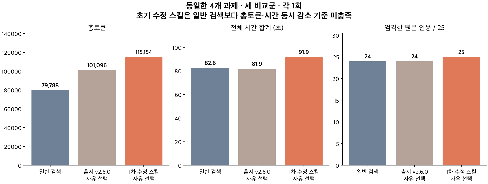
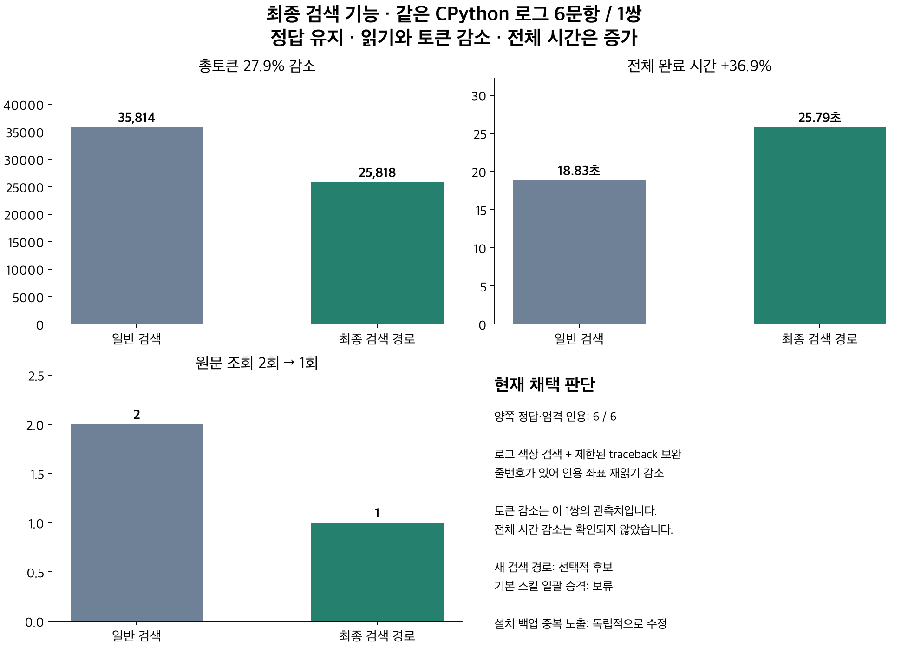

# Token Router 개선 후보 구현·검증

저장소에는 이 검토용 요약·그림·고정 질문만 포함했다. 아래 원시 이벤트/재채점 명령은 별도로 보존한 로컬 실험 폴더에서만 유효하다. 실제 모델 설정·인증·개인 경로가 있는 파일은 공개 검토본에 포함하지 않았다.

**판정: 기본 승격 기각, 새 검색 기능은 선택적 후보로 유지. 설치 백업의 중복 스킬 노출 수정은 독립적으로 검증됨.** 일반 검색보다 정확도를 유지하면서 총토큰과 전체 시간을 동시에 줄이는 기준은 충족하지 못했다.

## 구현

브랜치 `codex/focused-retrieval`, prototype package2.7.0-dev. 출시 v2.6.0 commit f68dc09를 기준으로 작성했다.

- `--search-term` 반복 옵션: 사용자가 지정한 case-sensitive literal 주변만 반환. AST/구조/무관한 tail을 추가하지 않는다. 코드12줄·로그4줄 주변을 합친다. 12,000자 및 공통 최종 상한을 넘으면 완전한 구간을 임의 절단하지 않고 보류한다. 로그 색상 SGR을 검색용 비교에서 제거할 수 있지만 반환 원문은 보존한다.
- 검색 결과에 걸린 traceback의 헤더/일치 원문이 있는 경우에만64줄 이내 마지막 예외까지 확장한다. 인접한 무관한 traceback의 끝만 겹친 경우 전체로 확장하지 않는다. 휴리스틱은 의미적 충분성을 보장하지 않는다.
- `--line-numbers`: 원문·좌표는 Packet.raw_slices에 유지하고 표시만 번호를 붙인다. 이 번호·헤더까지 출력 상한에 포함한다. 번호 출력의 길이를 승인 전에 검사하며, 기존 raw 기본 출력은 유지한다.
- SKILL 안내: 한 번의 검색으로 충분하면 종료; 분산 근거는 한 번에 조회; 이미 번호가 있는 근거를 인용 좌표 때문에 다시 읽지 않도록 정리했다.
- 설치 업데이트 백업을 `.agents/skills`·`.codex/skills` 밖의 `skill-backups`로 보관한다. 실제 로컬 discovery에서 후보+백업2개가 노출되던 문제를 재현했고, 수정 후 활성 후보1개를 확인했다.

공통 source guard·좌표 검증·최종 출력 상한, Python-only 기본값, v2.4 기본 정책은 유지했다. 별도 선택 모델이나 자동 복구 엔진은 추가하지 않았다.

## 같은 네 과제의 새 비교

동일한 CPython 코드/로그, SciPy 로그, attrs 코드와25개 질문을 고정했다. 모델gpt-6.1-sol/medium, Codex0.162.1, 각 군4episode·1회. 세 군 모두 첫 읽기를 자유롭게 선택하며 초기+추가2회 원문 조회 예산이 같다. 이전의 라우터 강제 실행 결과는 인과 효과 집계에 합치지 않았다.

| 방식 | 사실 정답 | 엄격한 인용 범위 | 총토큰 | 전체 시간 합계 | 원문 조회 |
|---|---:|---:|---:|---:|---:|
| 일반 검색 | 25/25 | 24/25 | 79,788 | 82.61초 | 7 |
| 출시 v2.6.0 스킬 | 25/25 | 24/25 | 101,096 | 81.92초 | 7 |
| 1차 수정 스킬 | 25/25 | 25/25 | 115,154 | 91.85초 | 6 |

1차 수정 스킬은 attrs 조회를2회→1회로 줄였지만, 일반 검색 대비 총토큰+44.3%, 시간+11.2%였다. 출시 스킬과 수정 스킬은 둘 다 넓은 라우터를0회 실행했다. 기존 v2.6.0도 이미 검색 우선 원칙을 갖고 있었으므로 이 우회를 새 구현의 성과로 세지 않는다. 이 시점에서 새 literal reader는 선택되지 않았고, 주로 안내 로딩과 검색 방식의 차이를 측정했다.

strict 실패1개는 CPython #0 인용에서 읽지 않은 중간 줄까지 범위를 넓혀 인용한 경우다. 정답pthread_kill과 실제 #0줄은 모두 제공됐지만, 보고한 인용 범위 전체는 보이지 않았다. 사실 정답과 범위 정확성을 구분한다. 원래 strict 점수는 보존했다.

## 최종 literal reader — 정리된 설치 환경

동일 CPython 로그6질문, 새 일반 검색 대조군과 최종 reader를 각1회 실행했다. 후보의 첫 조회에는 새 검색 옵션을 명시했다. 모델은 후보에서SKILL 읽기1회+원문 조회1회, 대조군에서검색1회+원문 조회1회를 사용했다. 전체 도구 호출은 둘 다2회여서 원문 읽기 수 감소가 모델 왕복 수 감소를 의미하지 않는다. 이는 기능 경로 비교이며 자동 선택 성능은 아니다. 선택 literal은 모델이 질문에서 골랐고 gold/사후 정답을 runtime에 주입하지 않았다.

| 지표 | 일반 검색 | 최종 검색 reader |
|---|---:|---:|
| 사실 정답 / 엄격 인용 | 6/6 · 6/6 | 6/6 · 6/6 |
| 총토큰 | 35,814 | 25,818 |
| 전체 완료 시간 | 18.83초 | 25.79초 |
| 원문 조회 | 2 | 1 |

총토큰은 **-27.9%**, 전체 시간은 **+36.9%**. 최초 reader가 끝까지 필요한 예외를 제공해 추가 원문 읽기를 줄였고 정답·인용을 유지했다. 그러나 전체 시간 감소는 확인되지 않았다.1쌍, 이미 본 자료이므로 일반화·통계적 유의성·범용 무열화를 주장하지 않는다. 서비스/캐시 차이도 통제되지 않았다.

이 최종 비교 전에 백업 스킬이 함께 노출되던2episode는 confounded trial로 보존했다. final literal reader의 입력·출력 수치를 그 오염된 회차로 대신하지 않는다. 첫 literal prototype의 별도2episode는 출력 cap/근거 부족으로 추가 읽기가 발생했으며, 개선 전 개발 자료로 보존했다. 그때 보류 응답도 비용에서 삭제하지 않았다.

## 검증과 비용

- 현재 전체158개 검사(POSIX에서 Windows 전용1개 skip), macOS Python3.10/3.14 통과; 기존10개 manifest 통과.
- 최종 기본 raw output은 같은 네 과제에서 v2.6.0과4/4 동일. 검색·번호·채색·traceback·범위·cap·source 변경·백업 discovery 경계 검사를 추가했다.
- 배포 후보 ZIP에서 설치/업데이트/복원/제거와 동봉 예제 smoke를 실행했다. 이번 후보의 Linux/Windows 원격 CI는 실행하지 않았다.
- 전체 새 실측18CLI, **497,658 알려진 토큰**. 모든 메인/도구/안내/추가 읽기 및 실패·오염 회차를 포함했고 cached/reasoning은 재가산하지 않았다. 사용량 미상0, 선택 모델0.
- 첫 비교와 개발 실측은16CLI/450,000토큰 admission 안에서436,026토큰으로 종료했다. 설치 계측 결함 확인 뒤에는 질문·방법을 바꾸지 않고 깨끗한 새 한 쌍(2CLI·60,000토큰 예약)을 따로 고정했다. 이 한 쌍은61,632토큰으로 **예약량을1,632초과**했고 알려진 usage 수신 즉시 종료했다. 이는 서버 hard cap이 아니며 예산 준수 성공으로 표시하지 않는다. CLI는 정상 종료하고 답은 완성돼 원시 결과와 비용을 보존했다.
- episode 전체 wall은 처음 입력부터 최종 답변까지다. 연구자의 준비/수정 대기 시간은 제외한다. CPU 또는 로컬 스캔 시간을 전체 모델 대기 개선으로 해석하지 않는다.

## 소스 식별과 재현

최종 기능 실측 code `e6481eb86de12406f07270532af899ae933e5ed9`.1차 기능은49f49ba, 중간 로그 기능은e20e030이며, 식별자는 버전 문자열과 별개다. 표본·프로토타입·실측 조건·정책·입력 hash를 각 execution-lock/product-lock에 기록했다. 원문은 과거 사용한 회귀 자료이며 새 잠금 평가가 아니다.

- report/summary.json: 모든 회차·세 비교군·오염 회차를 분리한 수치.
- 상위 manifest.json, product-lock.json, final-product-lock.json, clean-product-lock.json: 원문/질문 및 단계별 모든 모듈 hash.
- run-01, explicit-01, explicit-final, clean-final: 실제 prompt/instructions·CLI 이벤트·답·usage·종료 기록. 개인 경로가 든 command.json은 공개 자료로 배포하지 않는다.
- 무과금 재채점: 상위 `python3 score.py`; 요약/차트는 `python3 report.py`와 matplotlib 환경의`python3 plot.py`.

**채택 범위:** 중복 노출을 막는 설치 수정과 번호 표시의 안전 계약은 확인됐다. literal reader는 좁은 로그 사례에서 토큰/재읽기 개선을 관측한 선택적 후보다. 기본 스킬을 일괄 교체하거나 새 정식 릴리즈로 승격할 근거는 아직 부족하다. 전역 v2.6.0과 공개 릴리즈는 유지했다. 롤백은 이 후보 브랜치 대신 기존 main/tag v2.6.0을 사용하면 된다. 실험 원자료를 reset/덮어쓰지 않았다.
