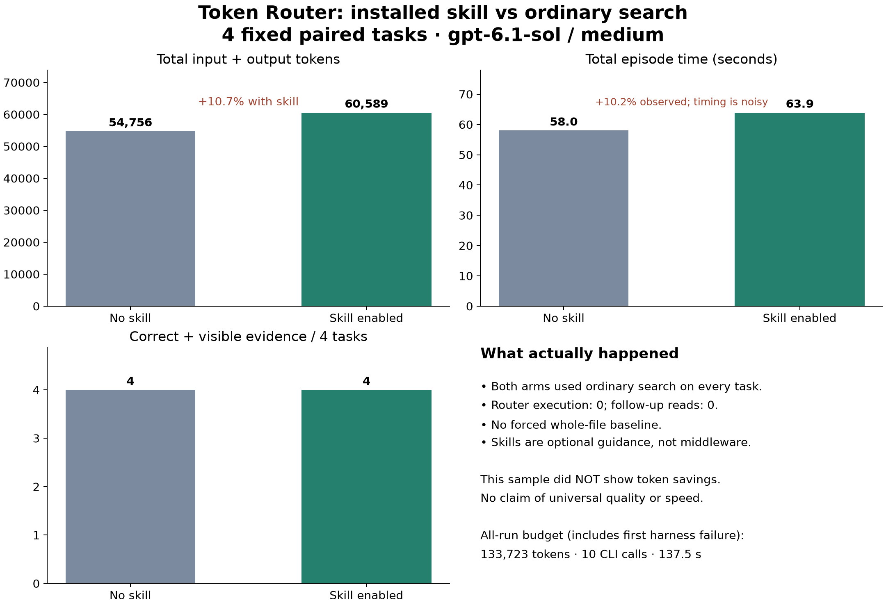
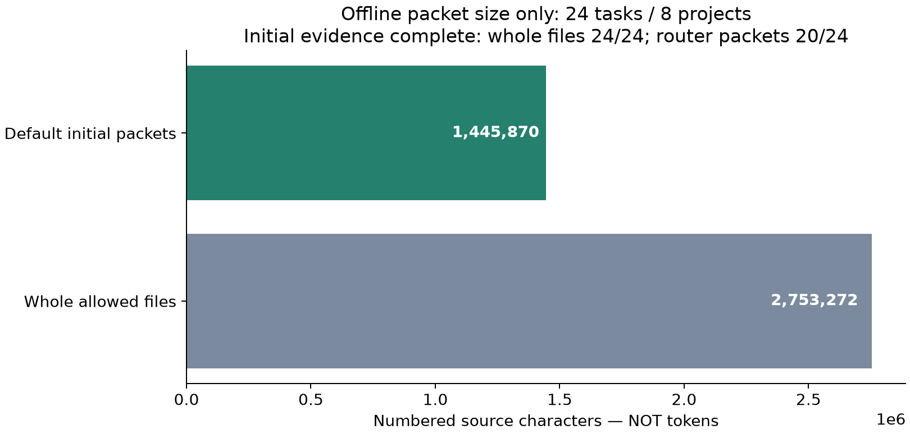

# Release candidate evaluation — 2.6.0

## Decision and actual skill comparison

**Keep v2.4/default return-context off. No universal savings claim.** The repaired tool-enabled harness completed all four fixed pairs after explicit user authorization; the initial accounting failure remains in the ledger. Both arms correctly answered 4/4 with citations actually present in returned command output. All eight episodes used one ordinary `rg` command, no router execution, no follow-up, no abstention. This validates explicit installed-skill use and avoiding needless routing, not automatic selection or successful routed recovery.



| Observed total | Ordinary search | Installed skill |
|---|---:|---:|
| Input + output tokens | 54,756 | 60,589 |
| CLI episode wall | 58.022s | 63.946s |
| Episode token median | 12,773 | 13,901.5 |
| Episode time median | 14.549s | 17.183s |
| CLI child CPU sum | 4.682s | 4.569s |
| Wall minus child CPU (proxy only) | 53.340s | 59.377s |
| Correct / completed with visible citations | 4/4 | 4/4 |
| Source retrievals / router calls / recovery | 4 / 0 / 0 | 4 / 0 / 0 |

Tokens increased **10.65%**, observed total episode time **10.21%**. Differences mix skill context, different search snippets, caching and model/runtime variance; they are not a controlled attribution to skill text alone. One repeat per task, no uncertainty or general non-degradation claim. Router local time is not applicable to these episodes because it was never invoked; the CPU column measures the CLI process tree, not router cost or pure network latency.

| Task | Plain tokens | Skill tokens | Paired token delta | Paired wall delta |
|---|---:|---:|---:|---:|
| attrs_own | 17,094 | 13,823 | -3,271 | -1.32s |
| log_first_warn | 12,116 | 13,968 | +1,852 | -2.13s |
| rust_capacity | 12,272 | 13,835 | +1,563 | +1.36s |
| ruff_language | 13,274 | 18,963 | +5,689 | +8.01s |

Median same-task deltas: **+1,708 tokens**, **+0.020s**. These are different from differences of group medians. The ruff task was the largest regression; attrs used fewer tokens with the skill. No post-result task replacement or further tuning run was performed.

## Accounting and provenance

Package2.6.0; default policyv2.4; return-context off; gpt-6.1-sol/medium; Codex CLI0.162.1; existing subscription. Four fixed source groups: attrs, loghub, Rust, ruff, alternating arm order. Identical question/allowed sources/common instructions/schema/retrieval allowance, except the explicit skill-versus-ordinary-search direction. Source versions/hashes: mixed-manifest.json. Per-prompt and common-instruction hashes, all five installed/final runtime hashes: paired-results.json. Private raw event hashes: raw-evidence-hashes.json. No private configuration/authentication or full third-party source is published.

Measured isolated installation is commit873de65 (SKILL hash identical to final). Harness code state538a03e with local repaired runner. The final router adds UTF-8/LF CLI stream configuration; its hash differs. Other four runtime modules match. The attempt to update that prerelease installation was refused because its managed file inventory differed; it stayed intact. No router execution occurred in the model episodes, so they are evidence about the identical installed SKILL workflow, **not a measurement of the final router's speed**. Current runtime was separately checked with 24 fixed local tasks. Future prerelease inventory mismatches require a new destination; the installer never guesses ownership.

Initial preflight:6,084 tokens; original unpaired plain episode:12,294. Its valid command event was rejected by the old packet-only usage parser. Original result is preserved; usage-correction.json records known raw usage. Repaired allow_tools accounting retains strict usage types/missing-field rejection and has a regression test. User explicitly authorized resuming. No extra preflight, model/account switch or budget increase.

Fresh paired episodes:115,345 tokens. **All attempts:133,723 known tokens,10 CLI invocations,137.505s model-stage wall**, including the initial15.499s. Usage unknown:false. Cached input/reasoning are subsets, not re-added. Original unpaired episode is excluded from paired effects, included in costs. Limits25CLI/350,000known tokens/600s; physical provider requests and server-side hard cap are unobserved. Tool count is instructed and audited, not a backend hard limit. All eight calls satisfied the three-retrieval allowance.

## Why earlier savings and this result differ

The historical v2.1 large-log comparison used **whole-source input versus routed input**, six questions per log, three repeats. Reported median total tokens were224,199→50,021 for CPython and277,788→52,567 for SciPy, about77.7%/81.1% reduction. These are historical product/model measurements, not remeasurements of2.6.0. The current four-pair study instead compares **one sufficient ordinary search versus skill-enabled ordinary search**. It never executes the router, so it cannot measure deterioration or retention of routed workflow token savings.

A new offline regression replay of the same four old files/queries compared public1737ae2 with the final runtime538a03e: **all four stdout outputs are byte-identical**, with zero model calls. CPython log551,034decoded source characters→112,673rendered output; SciPy632,478→104,380. Asyncio remains auto_full. This verifies preserved extraction behavior on those files, not new end-to-end tokens or accuracy. See historical-equivalence.json; old sources/gold/results were not modified. The recent mixed tasks also match24/24.

Product interpretation: use existing context or a sufficient exact search first; use extraction when substantial irrelevant context remains. Do not force skill activation for every question. Current evidence does not justify abandoning the preserved extractor, nor claiming new universal savings. The four-pair selection failed to exercise beneficial routed work, which remains a limitation of this new live evaluation.

## Offline packets, separately

24 frozen tasks/8 independent projects,12ko/12en; Python/JS/Rust/log/docs; source hashes pinned before evaluation. All24 default stdout hashes match public v2.5.0 commit1737ae2. All spans preserve source text. Optional bounded mode changed0/15 applicable tasks; exact target was provided only in2 eligible explicit questions. No broad M-default adoption evidence.

Initial packets contain all accepted facts in20/24. Missing: attrs_classvar (abstention); redis_encoder (second allowed file); redis_upper; rust_length (selection omission). Full allowed sources contain all24. Coverage is not answer accuracy. Three stress queries and synthetic resources are separate, not extra independent tasks.



Numbered whole-allowed-source characters:2,753,272; initial router packets:1,445,870 (**47.5% fewer characters**). This omits recovery and does not measure token savings. Full-source and packet initial evidence differ. Local wall/CPU observations are in summary.json/mixed-results-final.json; single runs are not optimization distributions. No whole-workflow speed claim comes from local scans.

Synthetic stresses: one-million-character line and250,001lines abstain with no raw output;15,000functions and truncated syntax complete boundedly. Peak process RSS and times are in stress-results.json; these are synthetic macOS measurements.

## Reproduce without models

From a fresh full Git clone containing baseline1737ae2:

```sh
python3 scripts/replay_release.py --workdir ../token-router-replay --fetch
python3 -m unittest discover -s tests
python3 scripts/run_router_tests.py tests/router-tests.json
```

`--fetch` explicitly downloads only manifest-pinned sources, verifies SHA-256, and never calls models. Without it, supply those source files under the same relative paths. Results refuse overwrite; use a fresh workdir. Runtime Python3.10–3.14; plotting alone needs matplotlib. A local Python3.14 installation lacked CA certificates during download; Python3.10 with its normal trust store downloaded and replayed successfully. Do not disable TLS verification. Source licenses/provenance are recorded separately; third-party source bodies are excluded from product/public data.

Archive smoke uses scripts/smoke_archive.py. Current local platform validation is macOS arm64Python3.10.20/3.14.5; Linux/Windows CI is prepared, not passed. Automatic selection, actual routed-agent recovery and live Luna remain unmeasured; local contract tests are not substitutes for those agent outcomes.
